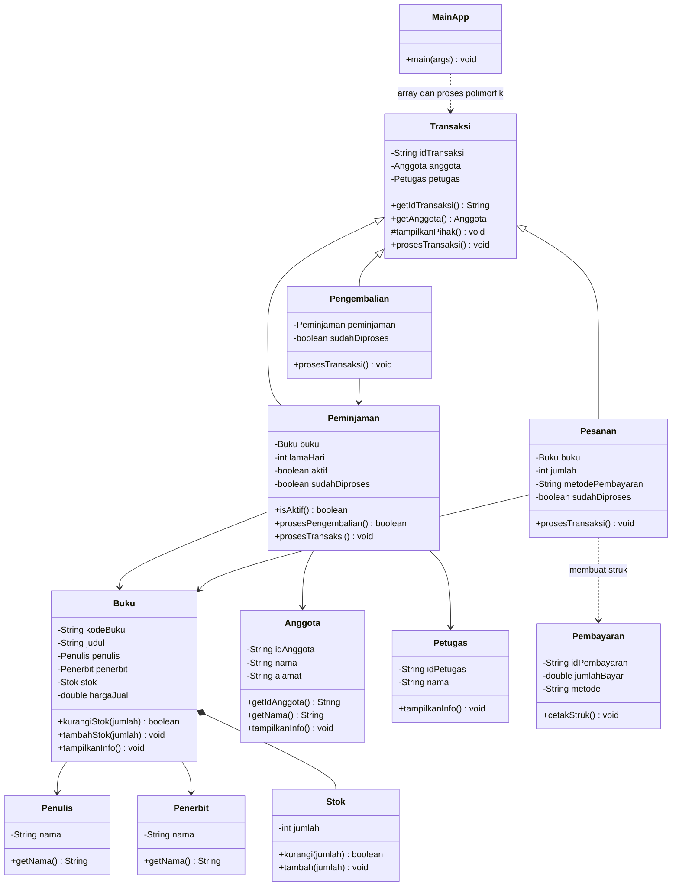
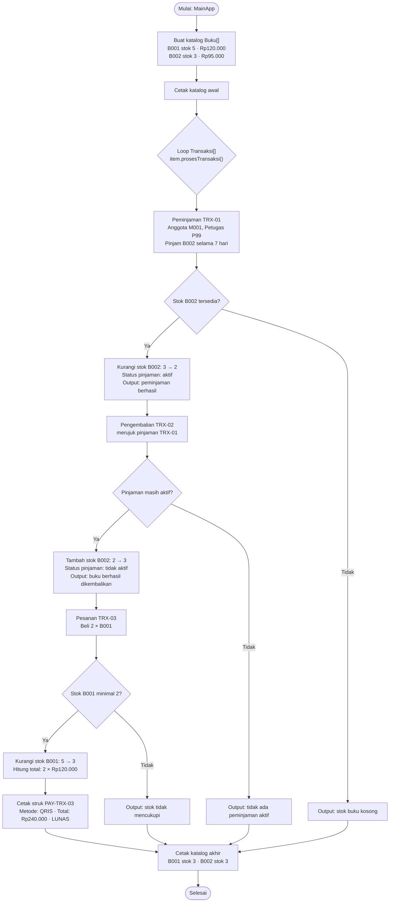

# BadWolf Store

Program Java sederhana untuk studi kasus 6 UTS Praktikum Pemrograman Berbasis
Objek. BadWolf Store mengelola katalog buku, stok, anggota, peminjaman,
pengembalian, pesanan buku, dan pembayaran.

## Struktur file & UML Class

```text
UTS/
├── Anggota.java       # Data anggota/pelanggan
├── Buku.java          # Data buku dan penghubung penulis, penerbit, serta stok
├── MainApp.java       # Titik masuk; menyiapkan data dan menjalankan demo
├── Pembayaran.java    # Data pembayaran dan cetak struk
├── Peminjaman.java    # Transaksi meminjam buku dan status pinjaman aktif
├── Penerbit.java      # Data penerbit
├── Pengembalian.java  # Transaksi pengembalian untuk suatu peminjaman
├── Penulis.java       # Data penulis
├── Pesanan.java       # Transaksi pembelian dan pembuatan pembayaran
├── Petugas.java       # Data petugas yang melayani transaksi
├── Stok.java          # Jumlah stok dan operasi tambah/kurangi
├── Transaksi.java     # Kelas induk data transaksi bersama
└── UML-Class.md       # Diagram kelas Mermaid
```



Seluruh file Java berada di package `UTS`. Setiap class memakai enkapsulasi:
atributnya `private`, sedangkan operasi yang dibutuhkan class lain disediakan
melalui constructor dan method publik.

## Rincian class dan API

Semua atribut di bawah bersifat `private`, kecuali disebutkan lain. Constructor
publik menerima nilai untuk atribut utama class, lalu method publik menjadi
jalur untuk membaca data atau menjalankan operasi bisnis. `Transaksi` memiliki
method `protected` untuk kebutuhan subclass.

| File / class                         | Atribut                                                                                                     | Constructor dan method penting                                                                                                                                                                                                                                                                   |
| ------------------------------------ | ----------------------------------------------------------------------------------------------------------- | ------------------------------------------------------------------------------------------------------------------------------------------------------------------------------------------------------------------------------------------------------------------------------------------------ |
| `MainApp.java` / `MainApp`           | Tidak menyimpan state aplikasi.                                                                             | `static void main(String[] args)` membuat objek contoh, katalog `Buku[]`, dan array `Transaksi[]`, lalu menampilkan katalog serta menjalankan transaksi.                                                                                                                                         |
| `Buku.java` / `Buku`                 | `String kodeBuku`, `String judul`, `Penulis penulis`, `Penerbit penerbit`, `Stok stok`, `double hargaJual`. | Constructor menerima kode, judul, penulis, penerbit, jumlah stok awal (`int`), dan harga (`double`). Getter mengembalikan kode/judul (`String`), stok (`int`), serta harga (`double`). `kurangiStok(int)` mengembalikan `boolean`; `tambahStok(int)` dan `tampilkanInfo()` mengembalikan `void`. |
| `Stok.java` / `Stok`                 | `int jumlah`.                                                                                               | Constructor menerima jumlah awal. `getJumlah()` mengembalikan `int`; `kurangi(int)` mengembalikan `boolean`; `tambah(int)` mengembalikan `void`.                                                                                                                                                 |
| `Penulis.java` / `Penulis`           | `String nama`.                                                                                              | Constructor menerima nama. `getNama()` mengembalikan `String`. Dipakai `Buku` untuk menampilkan informasi penulis.                                                                                                                                                                               |
| `Penerbit.java` / `Penerbit`         | `String nama`.                                                                                              | Constructor menerima nama. `getNama()` mengembalikan `String`. Dipakai `Buku` untuk menampilkan informasi penerbit.                                                                                                                                                                              |
| `Anggota.java` / `Anggota`           | `String idAnggota`, `String nama`, `String alamat`.                                                         | Constructor menerima ID, nama, dan alamat. `getIdAnggota()` serta `getNama()` mengembalikan `String`; `tampilkanInfo()` mengembalikan `void`.                                                                                                                                                    |
| `Petugas.java` / `Petugas`           | `String idPetugas`, `String nama`.                                                                          | Constructor menerima ID dan nama. `tampilkanInfo()` mengembalikan `void`.                                                                                                                                                                                                                        |
| `Transaksi.java` / `Transaksi`       | `String idTransaksi`, `Anggota anggota`, `Petugas petugas`.                                                 | Constructor menerima ID transaksi, anggota, dan petugas. Getter ID mengembalikan `String`; getter anggota mengembalikan `Anggota`. `tampilkanPihak()` bersifat `protected void`. `prosesTransaksi()` bersifat `public void` dan menyediakan perilaku umum untuk objek dasar.                     |
| `Peminjaman.java` / `Peminjaman`     | `Buku buku`, `int lamaHari`, `boolean aktif`, `boolean sudahDiproses`.                                      | Constructor menerima data transaksi, buku, dan lama pinjam. `isAktif()` mengembalikan `boolean`; `prosesPengembalian()` mengembalikan `boolean`; override `prosesTransaksi()` mengembalikan `void`. Class ini mengubah stok melalui `Buku`.                                                      |
| `Pengembalian.java` / `Pengembalian` | `Peminjaman peminjaman`, `boolean sudahDiproses`.                                                           | Constructor menerima ID, pinjaman yang dikembalikan, dan petugas. Override `prosesTransaksi()` mengembalikan `void`; delegasi ke `Peminjaman.prosesPengembalian()` menentukan apakah pengembalian dapat dilakukan.                                                                               |
| `Pesanan.java` / `Pesanan`           | `Buku buku`, `int jumlah`, `String metodePembayaran`, `boolean sudahDiproses`.                              | Constructor menerima data transaksi, buku, jumlah beli, dan metode pembayaran. Override `prosesTransaksi()` mengembalikan `void`; menghitung total dari harga buku dan jumlah, lalu membuat objek `Pembayaran`.                                                                                  |
| `Pembayaran.java` / `Pembayaran`     | `String idPembayaran`, `double jumlahBayar`, `String metode`.                                               | Constructor menerima ID, jumlah bayar, dan metode. `cetakStruk()` mengembalikan `void` dan mencetak ringkasan pembayaran.                                                                                                                                                                        |

### Hubungan antarclass

- Satu `Buku` menyimpan referensi ke satu `Penulis`, satu `Penerbit`, dan satu
  objek `Stok`. `Buku` mengelola akses stok agar transaksi tidak mengubah
  jumlahnya secara langsung.
- `Transaksi` menyimpan `Anggota` dan `Petugas`; `Peminjaman`, `Pengembalian`,
  dan `Pesanan` mewarisinya.
- `Peminjaman` menggunakan `Buku`; `Pengembalian` menggunakan objek
  `Peminjaman` yang sama agar dapat memeriksa dan menutup pinjaman aktif.
- `Pesanan` menggunakan `Buku` dan membuat `Pembayaran` setelah stok berhasil
  dikurangi. Objek pembayaran hanya dipakai untuk mencetak struk, tidak
  disimpan sebagai atribut.
- `MainApp` menggunakan array objek `Buku[]` dan `Transaksi[]` untuk mengelola
  beberapa item dan menjalankan transaksi polimorfik.

Relasi utamanya:

```text
Pewarisan:
Transaksi <|-- Peminjaman
Transaksi <|-- Pengembalian
Transaksi <|-- Pesanan

Hubungan objek:
Buku *-- Stok
Buku --> Penulis
Buku --> Penerbit
Peminjaman --> Buku
Pengembalian --> Peminjaman
Pesanan --> Buku
Pesanan ..> Pembayaran (membuat saat transaksi berhasil)
Transaksi --> Anggota
Transaksi --> Petugas
MainApp ..> Buku[] dan Transaksi[]
```

## Alur demo

`MainApp` membuat dua buku, seorang anggota, dan seorang petugas. Program
kemudian menjalankan isi `Transaksi[]` secara berurutan:

1. `Peminjaman` meminjam satu eksemplar buku B002 selama tujuh hari. Jika stok
   tersedia, stok berkurang satu dan pinjaman menjadi aktif.
2. `Pengembalian` merujuk pinjaman tadi. Jika masih aktif, stok bertambah satu
   dan status pinjaman dinonaktifkan.
3. `Pesanan` membeli dua eksemplar B001. Jika stok cukup, stok berkurang dua,
   total pembayaran dihitung dari harga dikali jumlah, lalu struk dicetak.
4. Katalog ditampilkan kembali untuk memperlihatkan stok setelah transaksi.

Array bertipe `Transaksi[]` berisi objek dari beberapa subclass. Pemanggilan
`item.prosesTransaksi()` memilih implementasi berdasarkan class objeknya
(polimorfisme).

### Ilustrasi alur dan output

Diagram ini menunjukkan urutan proses yang dicetak oleh `MainApp` serta
perubahan stoknya:



Ringkasan output normal:

```text
=== KATALOG BADWOLF STORE ===
[B001] ... | Stok: 5 | Harga: Rp 120000.0
[B002] ... | Stok: 3 | Harga: Rp 95000.0

=== PEMINJAMAN TRX-01 ===
Berhasil meminjam Struktur Data & Algoritma selama 7 hari.

=== PENGEMBALIAN TRX-02 ===
Buku berhasil dikembalikan.

=== PESANAN TRX-03 ===
Pembayaran PAY-TRX-03 | QRIS | Rp 240000.0 | LUNAS

=== STOK AKHIR ===
[B001] ... | Stok: 3 | Harga: Rp 120000.0
[B002] ... | Stok: 3 | Harga: Rp 95000.0
```

Jika stok habis atau tidak cukup, alur terkait menampilkan kegagalan dan tidak
mengurangi stok. Diagram menunjukkan cabang tersebut; ringkasan di atas adalah
output untuk data contoh yang saat ini disiapkan pada `MainApp`.

## Menjalankan program

Dari direktori induk repository:

```bash
mkdir -p out
javac -d out UTS/*.java
java -cp out UTS.MainApp
```

Demo berakhir dengan stok B001 sebanyak 3 dan stok B002 sebanyak 3. Nilai
tersebut menunjukkan pembelian mengurangi stok, sedangkan pengembalian
mengembalikan stok yang dipinjam.

## Cakupan

Program ini adalah demo berbasis data contoh, belum menyimpan data secara
permanen dan belum menyediakan input interaktif. Lama peminjaman dicatat untuk
ditampilkan, tetapi belum ada tanggal jatuh tempo atau perhitungan denda.
