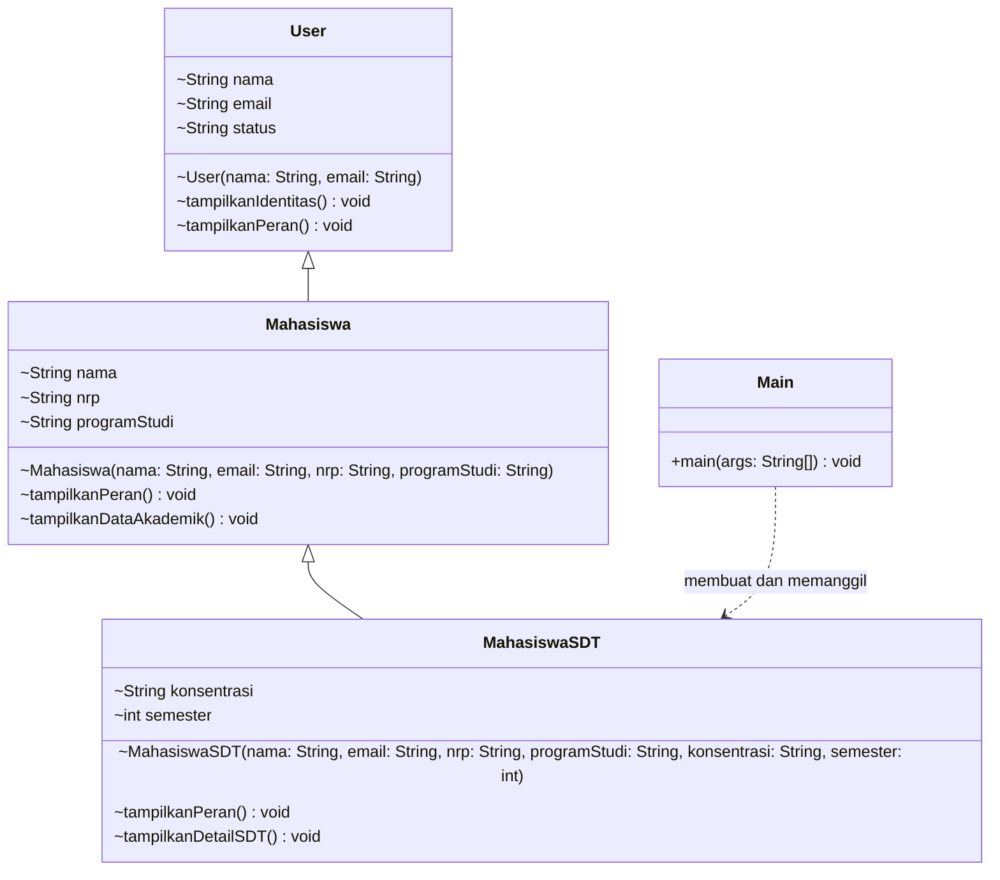

# UML Class

`~` menandakan akses package-private; `+` menandakan public. `main` bersifat static.

**Catatan:** `Mahasiswa` mendeklarasikan `nama` sendiri, sehingga field ini berbeda dan menyembunyikan `User.nama`.
