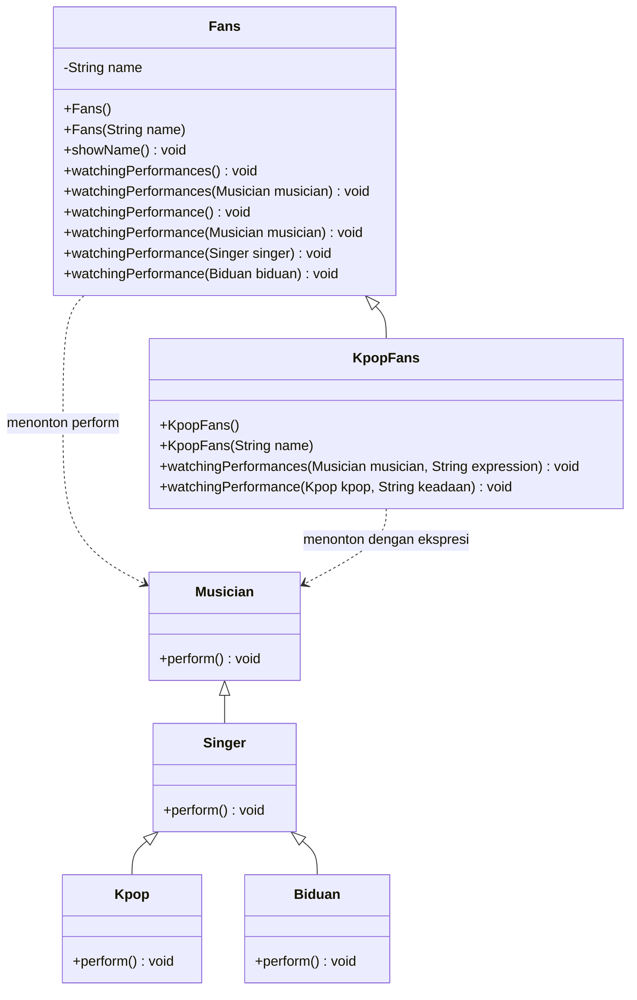

# UML Class Diagram P14

Diagram ini mempertahankan seluruh operasi yang telah ada di source dan
melengkapi operasi serta pewarisan sesuai screenshot tugas.

`watchingPerformance` (tunggal) tetap dipertahankan karena dipanggil oleh
`Test.java`; method `watchingPerformances` (jamak) melengkapi signature pada
UML soal. `Test.java` tidak diubah.
